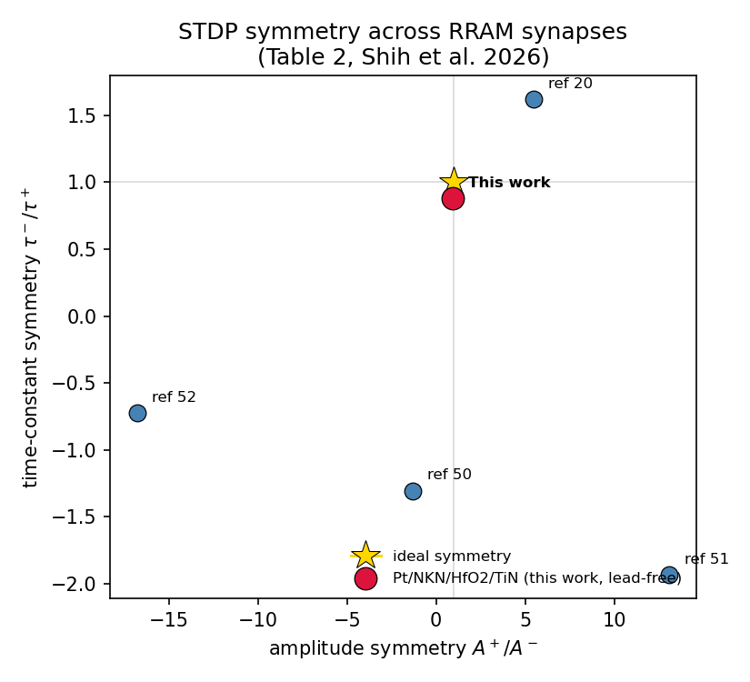

# Symmetric STDP in a lead-free NKN/HfO₂ memristor

A self-study reproduction of the spike-timing-dependent plasticity (STDP) rule reported for a
lead-free Pt/Na₀.₅K₀.₅NbO₃ (NKN)/HfO₂/TiN memristor synapse, and a test of that rule as a learning
rule in a small spiking neural network.

> **Source paper:** Shih, P.-A., Cheng, W.-C., Hsu, Y.-H., Hsu, K.-L., & Chu, S.-Y. Lead-free
> perovskite/TMO bilayer RRAM with symmetric STDP for neuromorphic computing.
> *Journal of Materials Chemistry C* (2026). [doi:10.1039/d5tc04557f](https://doi.org/10.1039/d5tc04557f)



## Highlights

- Reproduced the paper's STDP symmetry indices (A⁺/A⁻ ≈ 0.95, τ⁻/τ⁺ ≈ 0.88).
- The device sits close to ideal symmetry, an order of magnitude closer than four other published
  RRAM synapses.
- Used the device's rule as the plasticity rule of an unsupervised spiking network.

## In this repository

`stdp_kernel.py` is a minimal example of the published STDP equation. It plots the kernel and
prints the symmetry indices.

```bash
pip install -r requirements.txt
python stdp_kernel.py
```

The full analysis code is not public. Happy to discuss the work: see
[achyar99.github.io](https://achyar99.github.io).

Achyarul Mabruri · MIT licence for the code in this repository.
